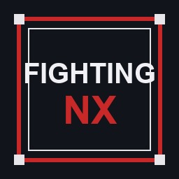

# FightingNX

A Nintendo Switch recompilation of **Fight Night Champion** (Xbox 360).

> **This repository contains no game data.** No code, graphics, sound, shaders or other files from Fight Night
> Champion are included, and none are distributed. To build and play you need **your own legally obtained copy of the
> game** (an Xbox 360 disc you own, dumped yourself). The game's code is translated from your copy on your own
> machine during the build, and its data files are read from your copy at run time.

## Status

Work in progress. The game now boots and fights are playable on Nintendo Switch at approximately 30 FPS, with occasional
small frame drops. Menus and cutscenes are stable, while fight performance and audio still need improvement. The audio
is already much cleaner in menus and fights, though a few issues remain during fights.

Known issues:

- Some occasional frame drops during fights
- Fighter shadows and occasional black artifacts
- A thinner-than-reference crowd
- Remaining fight audio crackle and mix issues
- Custom gear textures and some visuals need further work

The state of each problem, with measurements and evidence, is in [`docs/fnc/stage3.md`](docs/fnc/stage3.md).

The Windows build is a development and testing bench for the Switch port. This repository is focused on Nintendo
Switch support.

## How it works

- [ReXGlue](https://github.com/rexglue/rexglue-sdk) translates every PowerPC function of the game's executable to
  C++ ahead of time; the C++ is compiled for x86-64 (Windows) or ARM64 (Switch). Nothing is emulated at run time.
- The ReXGlue runtime stands in for the Xbox 360's kernel services (files, threads, memory, input, audio).
- **Renut**, a Direct3D-level renderer, draws through deko3d on the Switch instead of emulating the Xbox 360's GPU.
- The game-specific fixes (the function list, the SDK patch and the frame-rate work) come from
  [FNC Reborn](https://github.com/whompay/FNCReborn), the Windows recompilation of the game; the Switch work builds on
  [sa2-nx](https://github.com/ChanseyIsTheBest/sa2-nx).

## Building

You need your own dump of the game (the extracted disc contents, with `default.xex` and the data folders). Only use
game data that you legally obtained and dumped yourself.

### Windows installer

1. Set up [Python 3.10 or later with Tcl/Tk](https://www.python.org/downloads/windows/), Git, and
   [Visual Studio Build Tools](https://learn.microsoft.com/cpp/overview/acquire-msvc) with Desktop development with
   C++, a Windows SDK, and [C++ Clang tools for Windows](https://learn.microsoft.com/cpp/build/clang-support-msbuild).
   Use CMake 3.31 or newer and Ninja. The installer uses the copies in Visual Studio or on your PATH.
2. Install [devkitPro for Windows](https://devkitpro.org/wiki/Getting_Started). In its MSYS2 shell, install
   `switch-dev deko3d switch-libexpat switch-libzstd switch-zlib make zstd mingw-w64-clang-x86_64-clang`
   with `pacman -S --needed`. The first build also downloads the pinned SDK and shader tool dependencies.
3. Double-click **Install FightingNX.cmd**. Select the extracted game folder containing `default.xex`, `data` and
   `databigs`, and your devkitPro folder. This build supports media ID `2DC50868`, executable version `0.0.0.3`.
4. Click **Capture shaders**. When the Windows capture opens, let it reach the title screen, then visit the menus
   and modes you want to play. The first capture may have missing graphics. Close it and run **Capture shaders**
   again to draw with the shaders collected so far. Close the capture window before building.
5. Click **Build Switch folder**. When it finishes, use **Open SD card folder** and copy the `switch` folder onto
   the root of the SD card. Open FightingNX in hbmenu through a title override (hold R while launching a game).

The installer builds locally. Keep your disc files, captured shaders and generated NRO private. Builds and logs
are under `out/installer`. Shader coverage depends on the scenes visited during capture.

### Manual builds

- **Switch:** [`docs/fnc/stage3.md`](docs/fnc/stage3.md): devkitPro (devkitA64, libnx, deko3d) through pacman, then
  `tools\win\build_switch.ps1 -NoNvk`. The NRO goes to `sdmc:/switch/fnc-nx/` with your game files in `game_root/`
  next to it. Start it from hbmenu through a title override (hold R while launching a game) for full memory.
- **PC testing bench:** [`docs/fnc/stage1.md`](docs/fnc/stage1.md) documents the development toolchain used to diagnose
  and validate Switch fixes.
- **Renderer and shaders:** [`docs/fnc/stage2.md`](docs/fnc/stage2.md) describes the shader capture and translation
  loop. Shader packages are built from your own copy and are never committed.

The general sa2-nx documents in [`docs/`](docs) describe the shared tools; where they name Sonic Adventure 2 files,
use your Fight Night Champion dump instead.

## Contributing

Contributions are welcome. This project needs help with rendering, CPU and GPU performance, audio, testing and
debugging.

- Open an issue describing the problem, hardware or scene, and steps to reproduce it.
- Include a console log or profile whenever possible. Do not upload game files, extracted assets, decrypted data or
  copyrighted textures.
- Keep changes focused and explain the performance or correctness problem they solve.
- Run the relevant PC or Switch checks before opening a pull request.
- Renderer changes should include the affected scene or test setup.
- Audio and performance changes should include before-and-after measurements or recordings where possible.

Useful areas to help with include:

- Fighting scene graphics and shadow rendering
- Frame pacing and CPU/GPU performance
- Fight audio and mixer stability
- Custom gear texture handling
- Switch console testing and reproduction
- Code generation, profiling and native replacements
- Documentation and build tooling

Do not share or commit dumped game executables, game data, user save files or console logs containing them.

## Credits and licences

- [sa2-nx](https://github.com/ChanseyIsTheBest/sa2-nx) by ChanseyIsTheBest: the Switch SDK fork, tools and the Renut
  integration this port is built on (GPL-3.0, see [`LICENSE`](LICENSE)).
- [FNC Reborn](https://github.com/whompay/FNCReborn): the game's function list, SDK patch and hooks (Apache-2.0, see
  [`NOTICE.fnc-reborn`](NOTICE.fnc-reborn)).
- [ReXGlue SDK](https://github.com/rexglue/rexglue-sdk), reNut by masterspike52 (through banjo-nx), plume,
  XenosRecomp and the other libraries under `app/thirdparty` and `sdk/thirdparty`, each under its own licence.

Fight Night Champion is a trademark of Electronic Arts. This project is not affiliated with or endorsed by Electronic
Arts, Microsoft or Nintendo.
